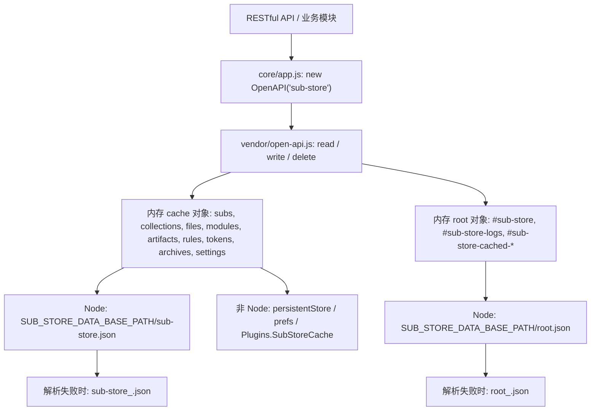

# Sub-Store 存储机制研究报告

> 研究对象：`https://github.com/sub-store-org/Sub-Store`
> 研究提交：`832d3a0412bf92e79b46d6610217117010c589ec`（2026-10-15），`backend/package.json` 版本 `2.42.5`
> 研究方式：浅克隆源码后逐文件追踪调用链，所有结论均给出源码位置作为证据。
> 说明：本报告只描述**当前实际实现**，对无法从源码确认的部分明确标注为“尚未证实”。

## 1. 核心结论

**Sub-Store 没有使用任何关系型数据库。** 没有 SQLite、没有 PostgreSQL、没有 MySQL，也没有任何 ORM（Sequelize/TypeORM/Prisma 等）。

它的持久化模型是：

> 单个进程内的 JavaScript 对象（`cache`/`root`）作为唯一数据源 + 序列化为 JSON 文件落盘。

在 Node 环境下，全部业务数据分别保存在数据目录下的 `sub-store.json`（业务数据）和 `root.json`（`#` 前缀的全局键，如日志、资源缓存、备份原始内容）两个 JSON 文件中。在其他宿主环境（Surge/Loon/QuantumultX/Egern）中，同样的 `cache` 通过 `$persistentStore` / `$prefs` / `$Plugins.SubStoreCache` 持久化。

关键澄清：

- 名为 `database.js` 的文件**不是数据库封装**，它只有 5 个纯数组操作的帮助函数。
- `SUB_STORE_DATA_BASE_PATH`（Docker 中常挂载为 `/opt/app/data`）只是**数据目录**，落到里面的是 JSON 文件，不是 SQLite 数据库文件。
- 业务数据、资源缓存、脚本缓存、日志都走同一套 `cache`/`root` 机制，区别只在键名前缀 `#`。

## 2. 证据链

### 2.1 `database.js` 是数组帮助函数，不是数据库

`backend/src/utils/database.js`（共 26 行）只导出四个函数：

```js
export function findByName(list, name, field = 'name') { ... }
export function findIndexByName(list, name, field = 'name') { ... }
export function deleteByName(list, name, field = 'name') { ... }
export function updateByName(list, name, newItem, field = 'name') { ... }
export function insertByPosition(list, item, position = 'bottom') { ... }
```

它们操作的对象是普通数组（内存中的 `subs`、`collections`、`files` 等），与数据库无关。

### 2.2 依赖清单中没有任何数据库驱动

`backend/package.json` 的 `dependencies` 只包含 HTTP、加密、YAML、Cron、MaxMind 等库（`express`、`undici`、`yaml`、`cron`、`@maxmind/geoip2-node`、`age-encryption`、`shoutrrr-ts` 等），**不存在** `sqlite3`、`better-sqlite3`、`pg`、`mysql2`、`sequelize`、`typeorm`、`prisma` 依赖。这直接排除了“用关系型数据库但被封装隐藏”的可能。

### 2.3 持久化入口：`OpenAPI` 单例

`backend/src/core/app.js`（共 5 行）：

```js
import { OpenAPI } from '@/vendor/open-api';
const $ = new OpenAPI('sub-store');
export default $;
```

所有业务模块通过 `$.read(key)` / `$.write(value, key)` / `$.delete(key)` 访问数据。真正的实现位于 `backend/src/vendor/open-api.js`（782 行）。

### 2.4 数据加载：`initCache()`（open-api.js L107–181）

按运行环境分支：

```js
if (isQX) this.cache = JSON.parse($prefs.valueForKey(this.name) || '{}');
if (isLoon || isSurge || isEgern) this.cache = JSON.parse($persistentStore.read(this.name) || '{}');
if (isGUIforCores) this.cache = JSON.parse($Plugins.SubStoreCache.get(this.name) || '{}');
if (isNode) {
    const basePath = eval('process.env.SUB_STORE_DATA_BASE_PATH') || '.';
    let rootPath = `${basePath}/root.json`;
    // ... 读取 root.json（root_<ts>.json 作为解析失败备份）
    let fpath = `${basePath}/${this.name}.json`;   // 即 sub-store.json
    // ... 读取主缓存文件（<name>_<ts>.json 作为解析失败备份）
}
```

要点：

- 数据目录来自 `SUB_STORE_DATA_BASE_PATH`，默认当前工作目录 `.`。
- 两个文件：`root.json`（全局 `#` 键）与 `<name>.json`，`name` 固定为 `sub-store`，即 `sub-store.json`。
- 文件解析失败时会 `copyFileSync` 生成带时间戳的备份（L130、L167），然后重新初始化为 `{}`。
- 兼容旧数据：主文件解析失败后尝试 `Base64.decode` 再解析一次（L157–163）。

### 2.5 数据写入：`persistCache()`（open-api.js L184–207）

```js
persistCache() {
    const data = JSON.stringify(this.cache, null, 2);
    ...
    if (isNode) {
        const basePath = eval('process.env.SUB_STORE_DATA_BASE_PATH') || '.';
        this.node.fs.writeFileSync(`${basePath}/${this.name}.json`, data, { flag: 'w' }, ...);
        this.node.fs.writeFileSync(`${basePath}/root.json`, JSON.stringify(this.root, null, 2), { flag: 'w' }, ...);
    }
}
```

每次写操作都会把**整个缓存对象**重新序列化并全量覆盖两个文件。没有临时文件 + rename，没有文件锁，没有事务。

### 2.6 读写语义：`#` 前缀分流（open-api.js L209–272）

`read` / `write` / `delete` 依据键名是否包含 `#` 决定写入哪个存储：

| 键名特征 | Node 存储位置 | 其他环境 |
| --- | --- | --- |
| 含 `#`（如 `#sub-store`、`#sub-store-logs`） | `this.root` → `root.json` | `$persistentStore` / `$prefs` / `$Plugins` 的独立键 |
| 不含 `#`（如 `subs`、`settings`） | `this.cache` → `sub-store.json` | 整包 JSON 存到 `this.name` 键 |

注意：任何读写都会触发 `persistCache()`（整包回写）。

### 2.7 业务数据键（`backend/src/constants.js`）

```js
export const SETTINGS_KEY = 'settings';
export const SUBS_KEY = 'subs';
export const COLLECTIONS_KEY = 'collections';
export const FILES_KEY = 'files';
export const MODULES_KEY = 'modules';
export const ARTIFACTS_KEY = 'artifacts';
export const RULES_KEY = 'rules';
export const TOKENS_KEY = 'tokens';
export const ARCHIVES_KEY = 'archives';
export const SCHEMA_VERSION_KEY = 'schemaVersion';
export const LOGS_KEY = '#sub-store-logs';
export const RESOURCE_CACHE_KEY = '#sub-store-cached-resource';
export const HEADERS_RESOURCE_CACHE_KEY = '#sub-store-cached-headers-resource';
export const SCRIPT_RESOURCE_CACHE_KEY = '#sub-store-cached-script-resource';
```

即：所有业务实体都是 `cache` 里的一个键，值是数组或对象。

### 2.8 Schema 迁移：`utils/migration.js`

用 `schemaVersion` 键做“版本标记 + 一次性数据搬迁”，例如 `migrateV2()` 读取旧的 `subs`/`collections`/`artifacts`/`rules`/`files`/`tokens` 后重写为数组形态，最后写入 `'2.0'`。这是应用级的数据改写，**不是数据库迁移**。

### 2.9 备份与恢复

存在三条独立路径：

1. **Gist 备份**（`restful/miscs.js` L158–177、L237+）：把整份 `$.cache` 序列化为 JSON，按 `base64` / `plaintext` / `age` 编码后上传到 GitHub Gist；下载时反向解码并 `$.write(content, '#sub-store')` 后整体替换 `$.cache`。
2. **启动还原**（`restful/index.js` L484–530）：环境变量 `SUB_STORE_DATA_URL` 指向的备份文件会在启动时下载、校验（必须含 `settings` 字段）、写入 `#sub-store` 并整体覆盖缓存。
3. **归档/回收站**（`utils/archive.js` + `restful/archives.js`）：删除订阅/集合/文件/产物/分享时保存快照到 `ARCHIVES_KEY`，支持恢复。这是**应用级软删除**，不是数据库备份。

快照通过 `JSON.parse(JSON.stringify(value))` 深拷贝（`archive.js` L17–22）。

### 2.10 并发与一致性

- 没有文件锁、没有事务、没有原子替换（无 `rename`）。
- 每次写都是“读时全量反序列化 → 内存修改 → 全量覆盖写”。
- 多请求并发修改时，`Node` 单线程事件循环能避免同一进程内大部分竞态，但**多进程/多副本部署会互相覆盖**；写入过程中断电或磁盘错误可能留下不完整文件（源码只在“解析失败”时做时间戳备份，不做写入原子性保护）。

## 3. 存储架构图



## 4. 数据类型与存储位置

| 数据类型 | 键 | Node 落盘位置 | 说明 |
| --- | --- | --- | --- |
| 设置 | `settings` | `sub-store.json` | 含 `gistToken` 等敏感项 |
| 订阅 | `subs` | `sub-store.json` | 数组 |
| 组合订阅 | `collections` | `sub-store.json` | 数组 |
| 文件 | `files` | `sub-store.json` | 数组 |
| 脚本/模块 | `modules` | `sub-store.json` | 数组 |
| 产物/托管 | `artifacts` | `sub-store.json` | 数组，含 cron 策略 |
| 规则 | `rules` | `sub-store.json` | 数组 |
| 分享令牌 | `tokens` | `sub-store.json` | 数组 |
| 归档快照 | `archives` | `sub-store.json` | 应用级回收站 |
| Schema 版本 | `schemaVersion` | `sub-store.json` | 迁移标记 |
| 日志 | `#sub-store-logs` | `root.json` | 全局键 |
| 资源/脚本/Header 缓存 | `#sub-store-cached-*` | `root.json` | TTL 缓存 |
| Gist 备份原始内容 | `#sub-store` | `root.json` | 备份体 |
| MMDB 数据库 | 文件 | `SUB_STORE_MMDB_COUNTRY_PATH` / `SUB_STORE_MMDB_ASN_PATH` | 外部数据文件，与业务数据无关 |

MMDB 是 GeoIP 数据文件，**不能**与业务持久化混为一谈。

## 5. 优缺点

优点：

- 实现极简，跨宿主（Node/Surge/Loon/QX/Egern）通用，一套代码多端运行。
- 数据即 JSON，便于导入导出、Gist 同步和人工排查。
- 无外部数据库依赖，单文件部署即可携带全部状态。

缺点：

- 全量读写，数据量大时性能与写入放大明显。
- 无原子写入、无锁、无事务，多进程/多副本不安全，异常退出可能损坏文件。
- 无索引、无查询能力，列表筛选只能在内存中做。
- 备份恢复靠整包 JSON，缺少增量、一致性校验和版本化 schema。
- 敏感数据（订阅 URL、token）与业务数据同存于明文 JSON。

## 6. SubFlow 的取舍

值得借鉴：

- 统一的实体抽象（订阅、集合、文件、脚本、产物、规则、令牌）。
- 单一数据根目录约定（对应 SubFlow 的“数据目录”配置）。
- 启动时可从远端 URL 恢复整库。
- 应用级归档/软删除与恢复。
- `schemaVersion` 驱动的数据迁移思路。

不应直接照搬：

- 用单个 JSON 文件承载全部业务状态。
- 全量覆盖写、无原子性、无并发保护。
- 把 `database.js` 这种命名用于数组帮助函数（易误导）。
- 把日志、资源缓存与核心业务数据混在同一存储层。

## 7. SubFlow 数据库选型结论

**结论：SubFlow 采用 SQLite 作为默认持久化方案，通过纯 Go 驱动（`modernc.org/sqlite`，无 CGO）访问，并配套版本化迁移、原子备份与恢复。**

理由：

1. SubFlow 目标是“可独立二进制 + Docker 双部署”的单机/小规模服务，SQLite 无独立服务进程，契合无外部依赖的一体化交付。
2. 相比 JSON 全量覆盖，SQLite 提供事务、原子提交、索引与并发读能力，直接消除了 Sub-Store 方案的一致性缺陷。
3. SQLite 文件是自包含单文件，备份/迁移只需处理一个文件，且能与 Docker volume、二进制模式共用同一数据目录约定。
4. 纯 Go 驱动无需 CGO，便于跨平台（linux/amd64、linux/arm64）交叉编译，满足二进制发布要求。

不选 PostgreSQL/MySQL 的理由：需要独立数据库进程，破坏“单二进制即部署”的目标，在目标规模下收益不足以抵消运维成本。当出现多实例、高并发或集中式运维需求时，再评估切换。

明确不选“文件/JSON 作为主存储”的理由：可以把 JSON 用于导入导出、配置模板和静态资源，但不应让它承担全部业务数据的持久化。
